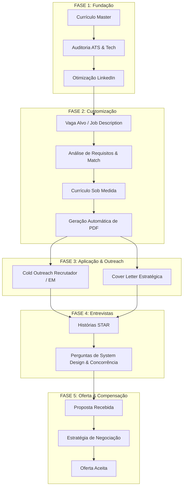

# 🗺️ Career & Application Roadmap: FAANG / Global Tech

Este roadmap descreve o ciclo de vida completo de aplicação para vagas de **Senior Backend Engineer** em Big Techs, empresas globais e unicórnios de tecnologia, integrando as 12 skills instaladas no repositório.

---

## 🧭 Visão Geral do Fluxo

---

## 📌 Fases Detalhadas

### 🔹 Fase 1: Fundação & Baseline (Semanas 1 e 2)
**Objetivo:** Ter uma base técnica inquestionável e um perfil público alinhado.

| Etapa | Ação | Skills Utilizadas | Entregáveis |
| :--- | :--- | :--- | :--- |
| **1.1** | Avaliar formato, densidade de keywords e legibilidade para robôs | `resume-ats-optimizer` | Relatório de conformidade ATS e correções de formatação |
| **1.2** | Transformar bullets passivos em impacto quantificado (Fórmula X-Y-Z) | `resume-bullet-writer` `resume-quantifier` | Bullets refinados com escala, latência, RPS e SLA |
| **1.3** | Balancear System Design, profundidade de código e liderança técnica | `tech-resume-optimizer` | Currículo Master (`curriculum/resume_en-us.md`) |
| **1.4** | Sincronizar o perfil do LinkedIn com o posicionamento do CV | `linkedin-profile-optimizer` | Headline, Sobre e Experiências do LinkedIn otimizados para busca |

---

### 🔹 Fase 2: Prospecção & Customização Cirúrgica (Contínuo)
**Objetivo:** Nunca aplicar com um currículo 100% genérico para vagas prioritárias.

| Etapa | Ação | Skills Utilizadas | Entregáveis |
| :--- | :--- | :--- | :--- |
| **2.1** | Desconstruir a Job Description da empresa alvo (ex: Stripe, Nubank, Amazon) | `job-description-analyzer` | Relatório de Match Score (%), gaps de requisitos e cultura |
| **2.2** | Adaptar resumo profissional e ênfase das experiências | `resume-tailor` | Versão sob medida do currículo para a vaga |
| **2.3** | Organizar e rastrear variantes para não perder o histórico | `resume-version-manager` | Versionamento estruturado de currículos |
| **2.4** | Compilar automaticamente a versão adaptada | GitHub Action (`generate-pdf.yml`) | PDF executivo de 2 páginas pronto para submissão |

---

### 🔹 Fase 3: Abordagem Ativa & Aplicação (Contínuo)
**Objetivo:** Fazer seu perfil chegar na frente da mesa do Engineering Manager ou Tech Recruiter.

| Etapa | Ação | Skills Utilizadas | Entregáveis |
| :--- | :--- | :--- | :--- |
| **3.1** | Escrever mensagem direta para Tech Leads / Hiring Managers | `cold-email-writer` | Mensagem curta, autêntica e sem tom de panfleto |
| **3.2** | Criar carta de apresentação personalizada para vagas internacionais | `cover-letter-generator` | Cover Letter conectando sua experiência de alta concorrência aos desafios da empresa |

---

### 🔹 Fase 4: Preparação para Entrevistas (Após First Contact)
**Objetivo:** Dominar a narrativa das entrevistas técnicas e comportamentais.

| Etapa | Ação | Skills Utilizadas | Entregáveis |
| :--- | :--- | :--- | :--- |
| **4.1** | Mapear cada bullet do seu currículo em histórias completas (STAR) | `interview-prep-generator` | Banco de respostas estruturadas (Situação, Tarefa, Ação, Resultado) |
| **4.2** | Antecipar sabatinas de System Design (Distributed Locks, Idempotência, Matera, Pix) | `interview-prep-generator` `tech-resume-optimizer` | Roteiro de defesa técnica de arquitetura e trade-offs |

---

### 🔹 Fase 5: Negociação Salarial & Total Compensation (Oferta na Mesa)
**Objetivo:** Maximizar o pacote anual (Base Salary + Signing Bonus + Equity/RSUs).

| Etapa | Ação | Skills Utilizadas | Entregáveis |
| :--- | :--- | :--- | :--- |
| **5.1** | Mapear benchmarks de mercado para Senior Backend / Staff no segmento | `salary-negotiation-prep` | Faixas de compensação esperadas (P50, P75, P90) |
| **5.2** | Construir roteiros e e-mails de contraproposta formal | `salary-negotiation-prep` | Scripts diplomáticos de contraproposta com base em valor entregue |

---

## 🎯 Métricas de Sucesso do Roadmap

- **Taxa de Conversão ATS / Recruiter:** > 30% de retorno em aplicações ativas.
- **Respostas de Cold Outreach:** > 15% de resposta em mensagens diretas para Hiring Managers.
- **Score de Entrevista Técnica:** Zero hesitação ao explicar decisões de concorrência, otimização de banco de dados e arquitetura de microsserviços.
